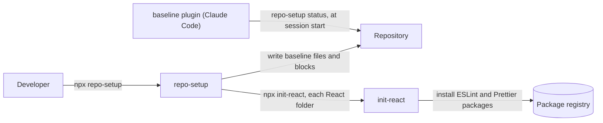

# `repo-setup`

> One command that sets up or updates any repository with the org's baseline: git files, git
> hooks, commit checks and Claude Code setup, for React, TypeScript, Java (Gradle) and Python
> folders, in any mix.

| | |
|---|---|
| **Type** | CLI (npm package) and Claude Code plugin |
| **Use it as** | CLI `npx @janesenaj42/repo-setup`; Claude Code plugin `baseline@repo-setup` |
| **Releases** | [CHANGELOG](CHANGELOG.md) |

## What it provides

| Part | Who runs it | What it provides |
|---|---|---|
| CLI, `npx @janesenaj42/repo-setup` | One developer, on a branch, then a PR | Writes the baseline files into the repository, which commits them. Runs once and exits |
| Claude Code plugin, `baseline@repo-setup` | Claude Code on every developer's machine, loaded from `.claude/settings.json` | Runs while Claude works ([Claude Code plugin](#claude-code-plugin)) |

The baseline files:

- **Git files:** a common `.gitignore`, `.gitattributes` and `.editorconfig` block at the root,
  and a `.gitignore` per folder.
- **Git hooks (lefthook):** lint and format on pre-commit, Conventional Commits on commit-msg,
  the branch-name check and tests on pre-push.
- **Lint and format config:** init-react in React folders; a fragment to merge for other stacks.
- **Claude Code setup:** `CLAUDE.md`, rules in `.claude/rules/`, and the plugin turned on in
  `.claude/settings.json`.
- **Pull requests:** checks a pipeline runs on each PR (PR title, branch name, PR description,
  Markdown links, JSON). The PR description is checked against the repository's PR template,
  or the organization's default one in its `.github` repository.

Per stack (React, TypeScript, Java with Gradle, Python): [What each stack gets](#what-each-stack-gets).

- Run it at the repository root, also in a monorepo: it finds every folder and gives each the
  hooks and checks of its stack. Don't run it in a sub-folder.
- In a repository with its own hooks or configs, it keeps them: a `lefthook.yml` command with a
  baseline command's name, its own commitlint config, its own files at baseline paths (`!` lines).
- **Use init-react instead when** you want only ESLint, Prettier and typecheck in one React
  project. In a repository that uses repo-setup, don't run init-react yourself: repo-setup runs
  it in each React folder.

---

## Quick start

**Requires:**

- Node.js 22 or later, for every developer of a repository that uses the baseline, whatever its
  stack: the git hooks and the Claude Code plugin run on Node.
- A token for the package registry, which GitHub Packages needs even to install:
  - **GitHub:** a personal access token (classic) with the `read:packages` scope, created under
    GitHub → Settings → Developer settings → Personal access tokens → Tokens (classic). GitHub
    Packages' npm registry doesn't accept fine-grained tokens. If the org uses SAML single sign-on,
    also click **Configure SSO** on the token and authorize `janesenaj42`.
  - **On-prem:** the Artifactory mirror's URL and a token that can read its npm repository.
- For the Claude Code plugin, on each developer's machine:
  - Claude Code;
  - git read access to repo-setup's repository (GitHub) or its mirror (on-prem), since Claude
    Code clones the plugin from there.

### Run it in a repository

1. Once per machine, add the registry to `~/.npmrc` (`%USERPROFILE%\.npmrc` on Windows).

   GitHub:

   ```ini
   //npm.pkg.github.com/:_authToken=YOUR_TOKEN
   @janesenaj42:registry=https://npm.pkg.github.com
   ```

   On-prem, the Artifactory mirror instead (`jfrog.dummy.org` and `npm` are placeholders: use the
   mirror's host and npm repository name):

   ```ini
   //jfrog.dummy.org/artifactory/api/npm/npm/:_authToken=YOUR_TOKEN
   @janesenaj42:registry=https://jfrog.dummy.org/artifactory/api/npm/npm/
   ```

2. In the repository, on a new branch:

   ```bash
   npx @janesenaj42/repo-setup --dry-run   # see what would change
   npx @janesenaj42/repo-setup             # apply it; runs init-react in React folders
   pnpm install                                # installs the git hooks; the last line printed names the tool
   ```

   The tool is the one the root lockfile shows. With no lockfile, a repository with a React or
   TypeScript folder gets pnpm when pnpm is installed (`npm install -g pnpm`); others get npm.

3. Commit, and open a PR.

4. After the PR is merged, every other developer, after cloning or pulling:
   1. Runs the install command (`pnpm install` or `npm install`) at the root, which installs the
      git hooks.
   2. Accepts Claude Code's trust prompt for the folder, which loads the plugin.

Run steps 2 and 3 again when:

- a new repo-setup version is released, or the plugin says the baseline files are out of date;
- a folder with a new stack is added (a React app, a Gradle service, a Python tool);
- a command is added to `lefthook.yml` with a baseline command's name, to replace it.

**Check it works:** `npx @janesenaj42/repo-setup status` prints nothing, and a commit with a
message that isn't a Conventional Commit is rejected.

---

## Guides

### Finish the steps that need a person

Lines marked `!` and the "Lint setup to merge" list are left to you, or to
`/baseline:adopt-baseline` in Claude Code:

- merging the stack's lint config fragment into your build files;
- moving another hook runner's hooks (husky) into `lefthook.yml`;
- your own file at a path the baseline uses. `--force` replaces it, after showing the diff and
  asking; `--force --dry-run` shows the diff only.

### Add your own lines to a file repo-setup owns

1. Add your lines after the last `# <<< baseline:` block, or your own file beside the
   baseline's. Rules: [`baseline.md`, "Files repo-setup owns"](baseline/files/.claude/rules/baseline.md#files-repo-setup-owns).

### Claude Code plugin

What it runs. The hooks are in [`hooks/hooks.json`](hooks/hooks.json), under Claude Code's own
event names:

| Event | When | What runs |
| --- | --- | --- |
| `PreToolUse` | Before each tool call | The guards in [`hooks/guard.mjs`](hooks/guard.mjs): no skipping the git hooks, no edits to files repo-setup owns, no reading `.env`, `*.pem` or `*.key` |
| `PostToolUse` | After Claude edits or writes a file | That folder's `onEdit` commands in `.baseline/claude-checks.json` |
| `Stop` | Before a turn ends | The `onStop` commands of each folder the turn changed |
| `SessionStart` | When a session starts | `repo-setup status`, plus a warning for a folder with no `node_modules` |

`.baseline/claude-checks.json` is not a Claude Code hooks file. It is the list of commands, one entry
per folder, that the `PostToolUse` and `Stop` hooks read ([What each stack gets](#what-each-stack-gets)).

How it's turned on:

- repo-setup writes `enabledPlugins` and `extraKnownMarketplaces` (repo-setup's git URL) into
  `.claude/settings.json`.
- Claude Code reads them when a developer accepts its trust prompt for the folder, and loads the
  plugin; there is no install command. A `claude -p` run in a folder never opened interactively
  has no plugin.

| Repository on | Git URL written |
|---|---|
| GitHub | repo-setup's GitHub repository (`repository.url` in `package.json`) |
| Another git host (on-prem GitLab) | None until you run `repo-setup --marketplace <git URL of the repo-setup mirror>` once; later runs keep it |

Update: `claude plugin marketplace update repo-setup`.

---

## Reference

### Commands and options

`npx @janesenaj42/repo-setup --help` prints these.

| Command or option | What it does |
|---|---|
| `repo-setup` | Set up or update the repository |
| `repo-setup status` | Say which files differ from this version of the baseline; change nothing |
| `repo-setup check` | Fail if a file repo-setup owns was edited (the pre-commit hook runs this) |
| `--dry-run` | Show what would change; change nothing |
| `--force` | Replace your own files at paths the baseline uses and your commitlint config file, and run the baseline's git hook commands instead of same-named ones in `lefthook.yml`. Shows each file as a diff and each command, then asks `[y/N]` |
| `--yes` | With `--force`, replace without asking. Without a terminal, `--force` changes nothing unless `--yes` is given |
| `--no-init-react` | Don't run init-react in React folders |
| `--marketplace <url>` | Git URL of repo-setup on your git host, where Claude Code gets the plugin ([Turn on the Claude Code plugin](#claude-code-plugin)) |

### What each stack gets

A folder's stack comes from its build file:

- `package.json` with `react` and `typescript` → react
- `package.json` with `typescript` only → ts
- `build.gradle(.kts)` with `gradlew` → java-gradle
- `pyproject.toml` → python

The source for this table is [`lib/stacks.mjs`](lib/stacks.mjs).

| Piece | react | ts | java-gradle | python |
|---|---|---|---|---|
| `.gitignore` in the folder | GitHub's `Node` | GitHub's `Node` | GitHub's `Gradle`, `Java` | GitHub's `Python` |
| `.gitattributes` lines | | | LF for `*.java`, `gradlew` | |
| `.editorconfig` sections | | | Java tabs (width 4), Kotlin 4 spaces | Python 4 spaces |
| Pre-commit, on staged files | ESLint, Prettier | ESLint, Prettier | `gradlew spotlessCheck` | Ruff format, Ruff check |
| Claude, after each edit | Prettier, ESLint `--fix` | Prettier, ESLint `--fix` | Spotless | Ruff |
| Claude, before a turn ends, on the changed files | Prettier, ESLint, `typecheck`, the tests that import them (Vitest or Jest; else `test`) | Same as react | Compile, the changed classes' tests | mypy, their tests |
| Pre-push, when the push changes the folder | `test` | `test` | `gradlew check -x test` | pytest |
| Claude rules | `typescript.md` | `typescript.md` | `java.md` | `python.md` |
| Lint and format config | init-react (frontend-dev-config), run for you | [fragment](baseline/fragments/ts/) to merge | [fragment](baseline/fragments/java-gradle/) to merge | [fragment](baseline/fragments/python/) to merge |

A folder with Playwright or Cypress gets no tests before a turn ends or on pre-push: they need
the app running.

Every repository also gets:

- a common `.gitignore`, `.gitattributes` and `.editorconfig` block at the root;
- commitlint (Conventional Commits, defaults) on `commit-msg`, unless the repository has its own
  commitlint config;
- the branch-name check on `pre-push`;
- the JSON and baseline checks on `pre-commit`;
- the Claude rules `baseline.md`, `docs.md` and `writing-style.md`;
- the ADR template;
- `CLAUDE.md` and `CONTEXT.md`, if it has none;
- `.baseline/checks/pr-description.mjs` and `markdown-links.mjs`, for a pipeline to run on each PR.

### Files repo-setup owns

- Lines between `# >>> baseline:` markers in `.gitignore`, `.gitattributes` and `.editorconfig`.
- Files with a `baseline-file sha256:` line.

The pre-commit hook rejects edits to them.

---

## How it works



- `lib/stacks.mjs` finds each folder's stack; `lib/apply.mjs` plans every change, which
  `--dry-run` prints and a normal run writes.
- Git hooks run through lefthook: the repository's `lefthook.yml` extends `.baseline/lefthook.yml`.
  lefthook runs an extended file's command over a same-named one in `lefthook.yml`, so
  `.baseline/lefthook.yml` leaves out every command `lefthook.yml` already names under that hook
  (with `--force`, it keeps them, and the baseline's run).
- A workspace in the same stack as its folder is part of the folder's Area. Claude's Stop hook
  runs the folder's commands in each changed workspace only, and skips a script the workspace
  doesn't have.
- Decisions: [docs/adr](docs/adr). Terms: [CONTEXT.md](CONTEXT.md).

---

## Limitations and troubleshooting

**Known limitations**

- No CI pipeline: add a workflow that runs the `.baseline/checks/` scripts on each PR.

**Troubleshooting**

| Symptom | Cause | Fix |
|---|---|---|
| `! Git hooks run through husky (.husky/), so lefthook can't install` | Another hook runner owns `core.hooksPath` | Run `/baseline:adopt-baseline`, or move those hooks into `lefthook.yml` |
| `! package.json scripts.prepare is "..."` | Your `prepare` script has no `lefthook install` | Add `lefthook install` to it |
| `! lefthook.yml already extends other files` | repo-setup won't rewrite your `extends` list | Add `- .baseline/lefthook.yml` to it |
| `! init-react failed in <folder>/` | init-react stopped with an error, printed above | Fix that error, then re-run |
| `! <file> is your commitlint config, kept` | commitlint reads one config, and the repository has its own | Make sure it extends `@commitlint/config-conventional`, or re-run with `--force` to replace the file with the baseline's |
| `! <folder>/ has no eslint or prettier` | The folder's lint and format hooks need them | Add them to the folder's `package.json`, and merge the lint fragment |
| `! <folder>/package.json has no "typecheck" script` | Claude's Stop hook or the pre-push hook runs it there, and fails without it (a workspace inside the folder may leave it out) | Add the script |
| `! .claude/settings.json: no source for the Claude Code plugin` | The repository isn't on GitHub, so repo-setup can't use its GitHub URL | Re-run with `--marketplace <git URL of the repo-setup mirror>` |
| `! .env has no .env.example` | Claude doesn't read `.env`, so it can't tell which variables exist | Add `.env.example` with each name and a placeholder value |
| `! .claude/settings.json has its own ... hooks` | Your Claude hooks run beside the plugin's | Remove the ones that check the same files as `.baseline/claude-checks.json` |
| A command in `lefthook.yml` doesn't replace the baseline's | It was added after repo-setup last ran | Re-run repo-setup |
| Commit rejected by the baseline check | A file repo-setup owns was edited | Undo the edit; put your lines after the last block, or re-run repo-setup |

---

## Support and contributing

- **Questions and bugs:** open an issue in this repository.
- **Run it from source, release it, or change it:** see [CONTRIBUTING.md](CONTRIBUTING.md)
